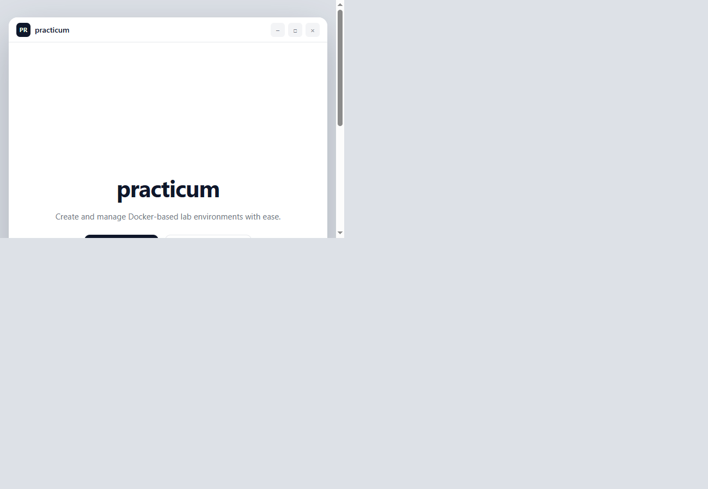
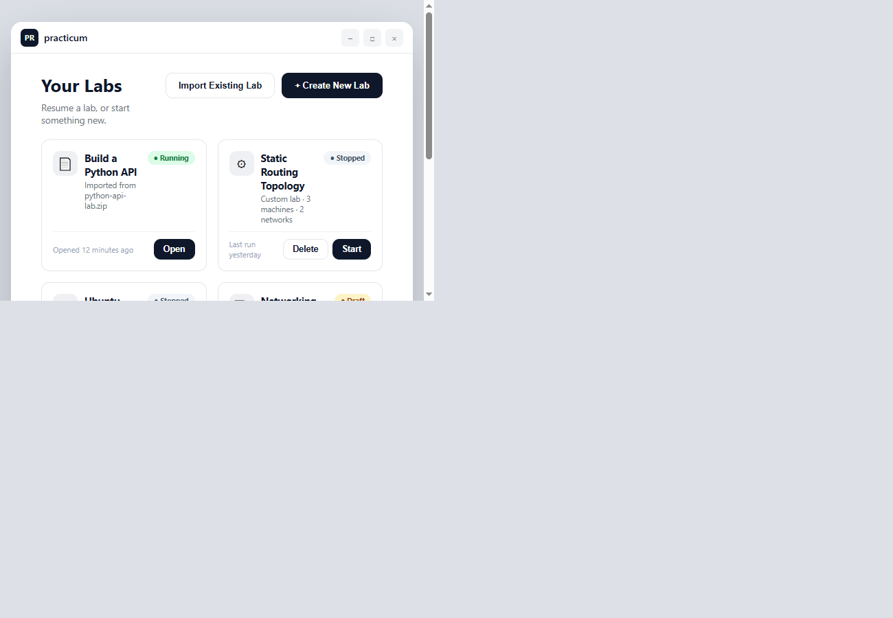
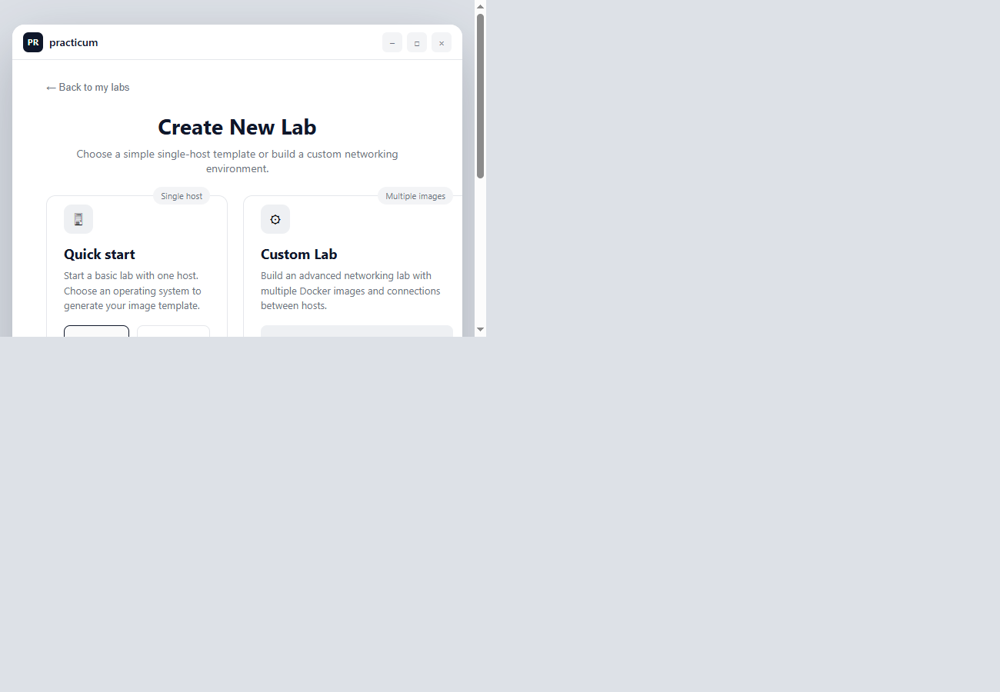
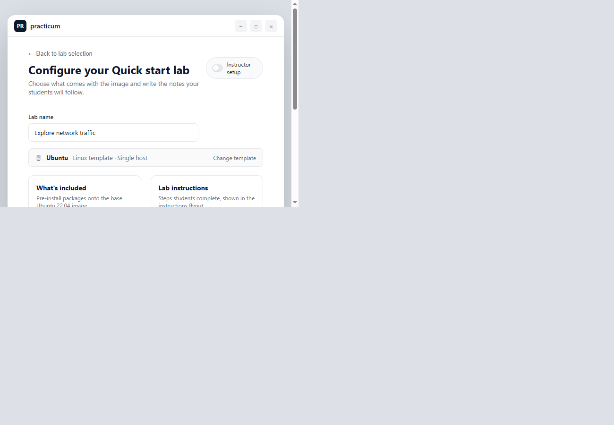
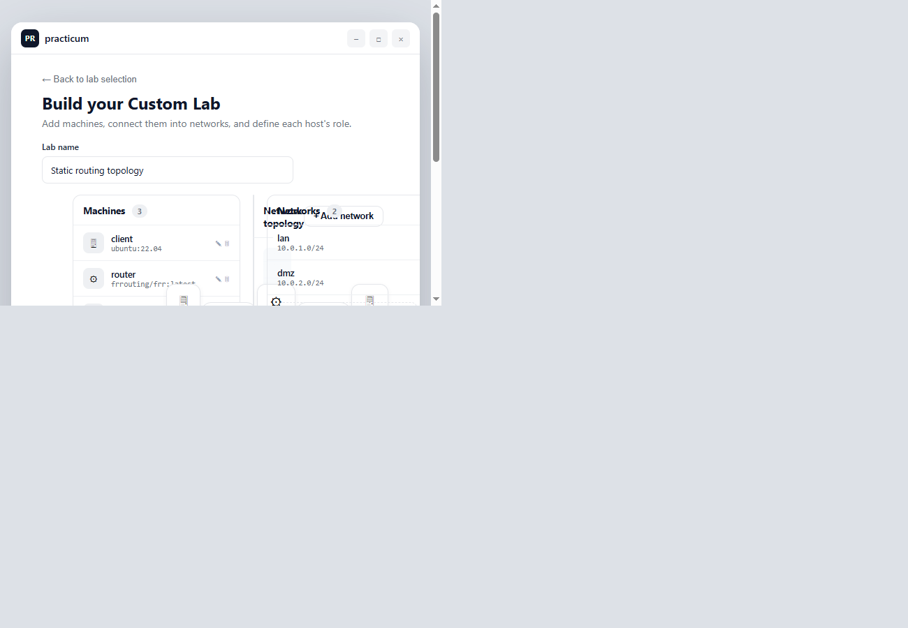
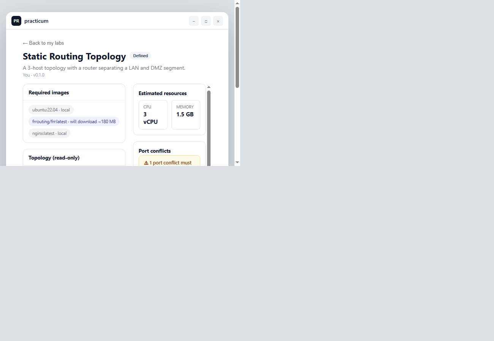
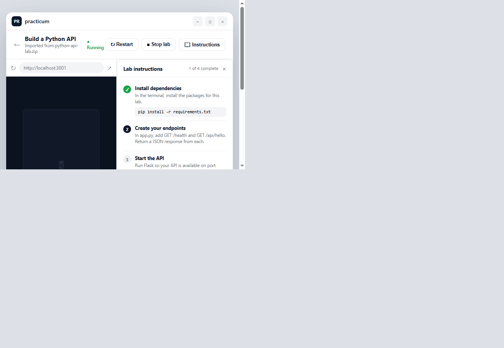
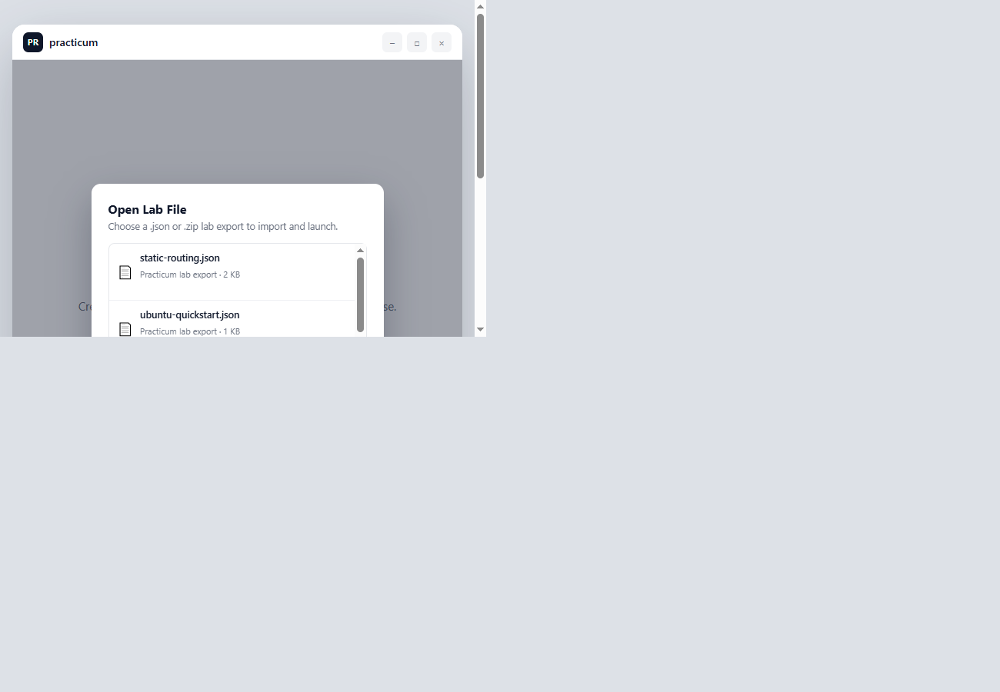

# Practicum

Practicum is a local-first API for defining and eventually running reproducible
academic networking labs on student-owned hardware.

The first milestone defines the API contract. It accepts a network topology as
JSON, validates its references and addresses, and stores the definition in
memory.

## API

- `GET /health`
- `POST /labs/validate`
- `POST /labs`
- `POST /labs/import`
- `GET /labs`
- `GET /labs/{lab_id}`
- `GET /labs/{lab_id}/export`
- `GET /labs/{lab_id}/preview`
- `POST /labs/{lab_id}/start`
- `POST /labs/{lab_id}/stop`
- `POST /labs/{lab_id}/reset`
- `GET /labs/{lab_id}/status`
- `GET /labs/{lab_id}/ports`
- `POST /labs/{lab_id}/ports/apply-recommendation`

Interactive API documentation is available at `/docs`.

## Development

Python 3.12 or newer is required.

```powershell
py -m venv .venv
.\.venv\Scripts\Activate.ps1
python -m pip install -e ".[dev]"
uvicorn practicum.main:app --reload
```

Run the tests:

```powershell
pytest
```

Validate the example topology after starting the API:

```powershell
Invoke-RestMethod `
  -Method Post `
  -Uri http://127.0.0.1:8000/labs/validate `
  -ContentType application/json `
  -InFile examples/static-routing.json
```

## Next milestone

Add a runtime interface and a Docker implementation for starting and stopping
the containers and networks represented by a validated lab definition.

## Design Mockups

The screenshots below are from a clickable HTML prototype of the desktop
application ([design/practicum-mockups.html](design/practicum-mockups.html)),
used to validate the end-to-end instructor and student experience before
building each screen in the real PySide6 app. Open the file directly in any
browser to click through the flows yourself.

| Welcome | Your Labs dashboard |
| --- | --- |
|  |  |

| Create New Lab | Quick Start configuration |
| --- | --- |
|  |  |

| Custom Lab designer | Pre-start readiness gate |
| --- | --- |
|  |  |

| Lab running (embedded view + instructions) | Import an existing lab |
| --- | --- |
|  |  |

See [src/user-stories.md](src/user-stories.md) for the full, phased backlog
these mockups are driving, including which screens are implemented in the
real desktop app today versus still planned.
